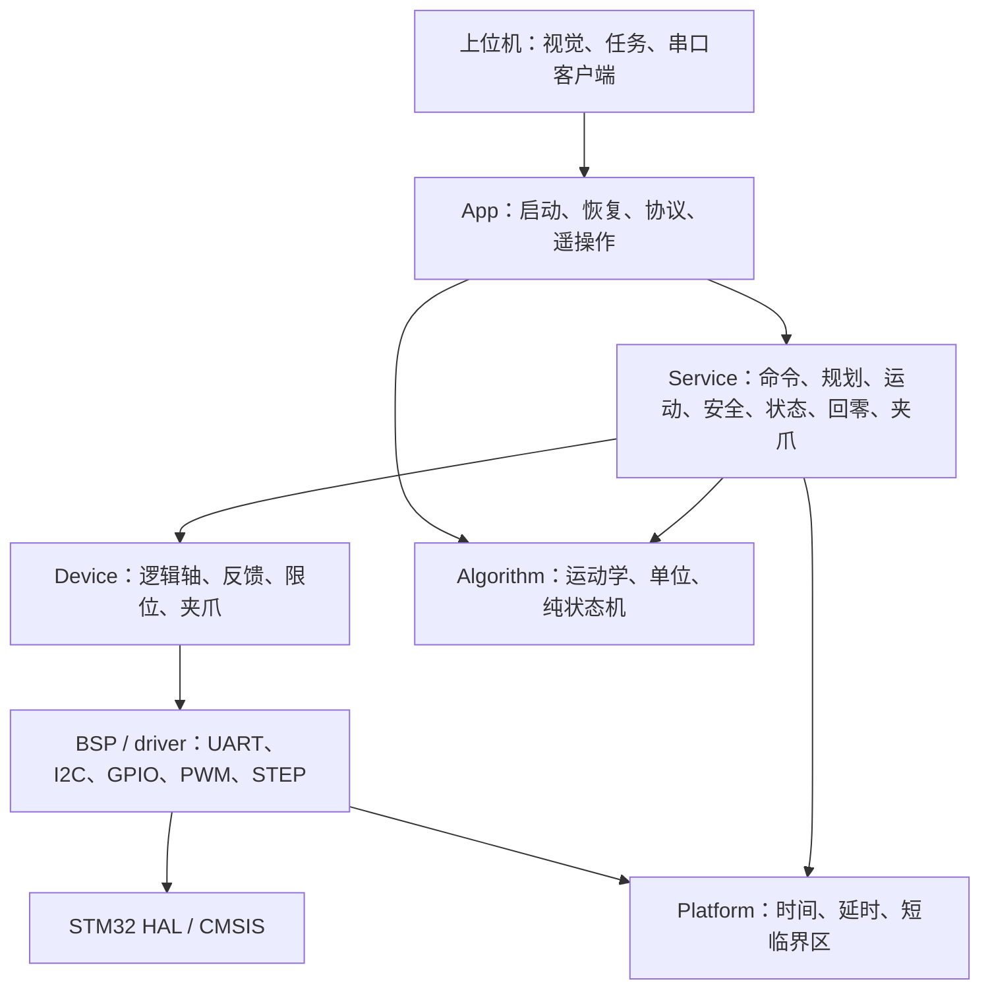
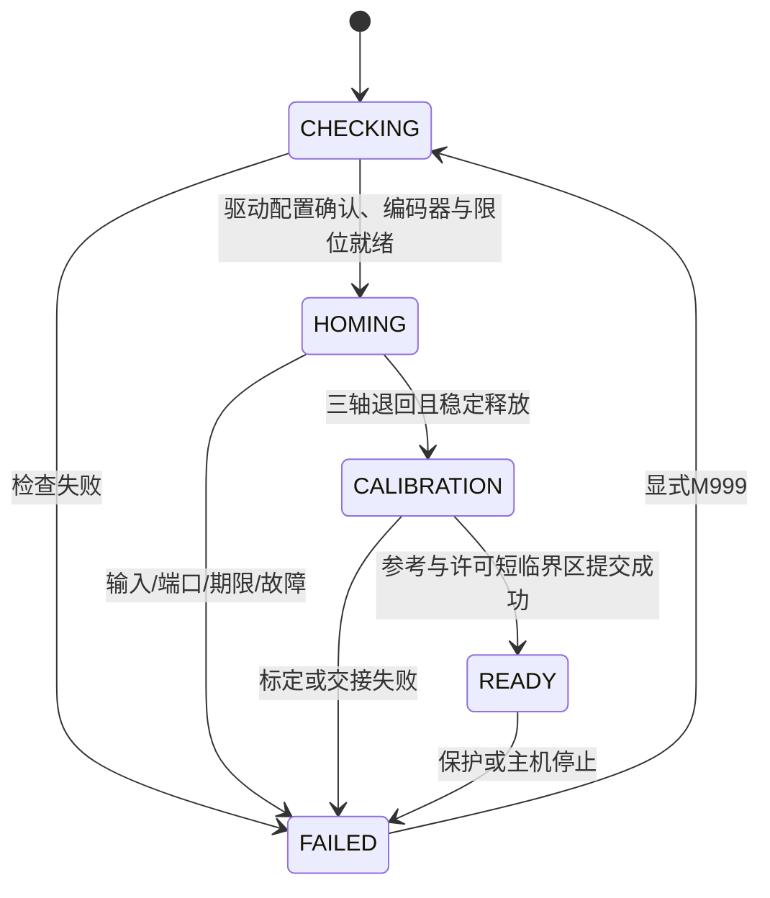

# 当前软件架构

本页描述Production GPIO逐轴方案。历史EXTI版及早期诊断说明保留在engineering_history；物理验证状态以hardware_validation/latest.json为准。

## 1. 依赖和状态归属

| 层 | 负责 | 不负责 |
|---|---|---|
| Algorithm | 运动学、微步换算、回零与消抖状态转移 | GPIO、HAL、等待外设 |
| Platform | 单调时间、回绕、短临界区 | 回零方向、故障策略 |
| BSP/driver | MCU外设与芯片帧协议；TMC CRC/地址/读回 | 任务排队、动作授权 |
| Device | 逻辑M1/M2/M3到外设的映射、反馈零偏 | 上位机命令会话 |
| Service | 本域状态、公开业务接口、故障与动作许可 | 跨域私有实现、串口文本 |
| App | 装配、正常启动/M999、协议和模式编排 | 直接改GPIO/芯片寄存器 |

具体适配例外是App/adapters：把HAL回调转换为逻辑事件，属于明确的硬件边界。`scripts/check_architecture_dependencies.py`检查直接依赖、服务私有域及公共头文件HAL泄漏。

## 2. 从一条命令到输出

`UART1 DMA → uart_line_reader → AppSerial → GCodeParser → CommandService → PlanningService → Ctrl_Planner → MotionService → Ctrl_MotionEngine → Dev_Joint → Drv_Stepper`。

完整行组帧只解决收发；路径先校验，再分预算生成帧。路径点队列、规划生成状态和STEP帧队列是三种状态，M112须同时取消未来请求和执行帧。G0/G1受理与实际完成不同，M400仅等待软件运动队列和闭环恢复结束。

夹爪路径为`AppSerial/Teleop → CommandService或Svc_Gripper → MotionService_IsActionAllowed → Dev_Gripper → Drv_Servo`。安全服务不反向调用运动服务，运动故障由App映射到安全首因。

## 3. 启动和恢复

M999重新确认TMC配置、输入、回零和编码器零偏；旧HOMED不能用于解锁。参考提交与故障复查构成有界事务，I2C和日志留在临界区外。正常READY保留EN使能；断能/故障后参考失效，不能以历史READY或旧M114规划值继续运动。

## 4. 回零及限位

每轴依次`SEEK → CONTACT → BACKOFF → RELEASE → GAP`，最后DONE。1ms回零服务只读GPIO并应用有限STEP/DIR/EN请求。首低立即暂停；连续低10ms确认压下；未确认接触恢复高10ms则回原寻程，等待完整周期再发步；持续不稳定100ms失败。

寻位和退回周期2ms，500微步/秒；每次1ms调用最多一个上升请求，不循环追赶。单轴寻位超时关闭，整轮220秒截止保留。M1/M2/M3退4000/1240/400微步，方向D1/D1/D0。启动已压住按当前位置固定退回，释放未确认不能完成。

正常READY的LimitStateFilter独立工作：首低先停STEP并保持EN，稳定低10ms锁定LIMIT并断能；稳定高10ms取消短脉冲；持续不稳定100ms锁定输入故障。PC10/11/12是普通上拉GPIO，限位EXTI关闭；rearm接口只是释放确认，不会重开EXTI。

## 5. 调度、并发与保持力

主循环：协议、就绪检查、规划预算、反馈、闭环、遥操作与夹爪保持结束处理。SysTick：1ms采样及回零。TIM6：普通运动STEP消费，发步前再次检查限位门禁。UART DMA回调只收数据，不执行动作。

共享状态用短临界区；不在ISR读I2C、打印或延时。部分初始化和I2C仍为阻塞接口，本工程不声称全系统硬实时。电脑测试不测量实际脉宽、保持力或负载能力。

三轴共用EN，无法通过此引脚单独给某轴保持力。普通空闲不发STEP但保持使能；完全断能会释放保持力，M3可受重力移动。当前试验外壳完成即断能并撤销HOMED/许可；新的10秒保持验收仍受一次START、350ms租约、250ms主循环心跳及整轮220秒保护，保持窗口拒绝新STEP/PWM和排队任务。

## 6. 教学与测试边界

公开头文件先讲合同，纯算法再讲状态和单位，最后讲端口应用和App装配。电脑测试替换设备/时间/HAL通信，真实业务源码保持一致；GPIO实际模式与输出锁定另做最终ELF审计。

机械关节参考、减速比、方向与笛卡尔几何见robot_home_pose/robot_config。编码器置零建立局部参考，不自动完成视觉标定；M3退回由5°变10°后物理参考姿态的绝对精度仍须实机核对。软件已实现与待实测事项分别列在软件交付清单和集中实机验收计划。
