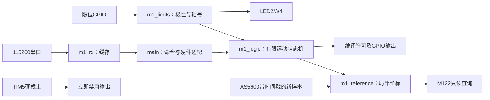

# M1单轴模块：职责、坐标与测试

阶段54在主机侧分出`axis_home_contract`纯解析层与`execute_axis_home_after_approval`一次会话调度层；参数门禁在构造通信对象之前。合同负责轴身份、状态/输出一致性、反馈新鲜度、所选限位及局部参考；调度负责CONFIG/DIR/HOME/KEEP顺序、时间、claim、连续记录及失败收尾。通过电脑测试不生成机械方向事实或动作许可。Debug/Release各111项通过；用户已断电，本阶段无实机访问。

阶段52已验证M3选轴的锁定检查和一次20微步点动，当前是M3动作版已用会话、共用EN禁用；三电机按用户更新授权均连接。阶段53新增纯离线`jog_trace_report`，依赖关系为执行日志→结构/合同检查→反馈统计→报告，不反向调用固件或串口。动作合同、运动证据、机械方向/精度和HOME分别记录，Debug/Release各109项通过。下述48/50/51为对应功能的历史记录。

阶段50增加[公共选轴准备](AXIS_PREPARATION.md)：axis_binding收敛M1/M2/M3的引脚、UART节点和限位位图，复用本页状态机与参考模块。默认仍选M1；M2/M3使用AXISHOME1并显式报告轴号。阶段51已部署M2版本，通过锁定检查并完成一次20微步D0点动、自动记录及禁用收尾；机械方向和精度未验收。下述阶段48是M1参考功能的历史实测，当前板上为M2已使用会话。

本目录是独立验证入口，正常三轴应用仍在`RobotArm`中。M1身份保留M1HOME8；M2/M3身份为AXISHOME1。阶段47完成M1锁定版230轮只读查询；阶段48的M1一次HOME寻35/退40成功，M122从UNSET转VALID。阶段51的M2仅点动，参考仍UNSET，未设置整机HOMED或开放运动许可。

## 模块依赖与编写顺序

| 阅读/编写顺序 | 模块 | 接收什么 | 负责什么 | 不负责什么 |
|---|---|---|---|---|
| 1 | `m1_limits.h/.c` | GPIO寄存器快照 | 统一低有效极性、轴号、LED写掩码和1ms历史 | 运动决策、机械零位 |
| 2 | `m1_logic.h/.c` | 逻辑限位、反馈有效性、毫秒时钟、主机续约 | 有限STEP计数、触发确认、小退回、失败停机和一次会话 | I2C、打印、坐标换算 |
| 3 | `m1_reference.h/.c` | 运动状态快照及带读取起止时间的编码器样本 | 判断局部参考能否建立/保持，计算相对角度 | GPIO、STEP、使能、整机HOMED或运动许可 |
| 4 | `m1_rx.h/.c` | 串口接收字节 | 有界缓存、硬件错误/溢出记录 | 解释坐标、运行HOME |
| 5 | `m1_deadline.h/.c` | 明确期限 | 装载TIM5并识别真正截止中断 | 自动启动动作、扩大业务期限 |
| 6 | `main.c` | HAL、上述纯模块、设备驱动 | 硬件绑定、主循环采样、命令调度、临界区与输出落实 | 正常三轴运动规划、夹爪控制 |
| 7 | `execute_home_after_approval.ps1` | 显式动作授权开关及精确固件回复 | 一次HOME监督、续约、连续反馈和异常取证 | 自动授权、自动重试或自动扩大行程 |

先完成1、2、3的电脑测试，再接硬件端口，最后使用主机监督脚本。该顺序按依赖组织，不要求课程章节与文件一一对应。



## 两个状态机分别说明什么

运动状态机：`IDLE → SEEK → QUALIFY → BACKOFF → DONE`。初始限位必须松开；SEEK第一次采到触发便停止向前发STEP，连续10ms后才反向。退回40微步且确认释放才成功。JOG另走`IDLE → JOG → DONE`。所有失败和已使用会话都不能重放。

参考状态机：`UNSET → WAIT_SAMPLE → VALID`，错误进入锁存的`INVALID`。

| LOCAL_REF | 状态 | 含义 |
|---|---|---|
| 0 | UNSET | 尚无成功HOME；JOG完成也保持该状态 |
| 1 | WAIT_SAMPLE | HOME已完成，等待完成之后发起的新编码器读取 |
| 2 | VALID | 局部原点已记录，持续用新样本更新相对角 |
| 3 | INVALID | 超时、无效反馈、限位触发、配置或运动状态异常；不自动重建 |

参考REASON：0正常、1尚无HOME、2等待新反馈、3反馈失效、4限位触发、5运动状态异常、6配置无效、7等待新样本超时。非零数值应结合状态阅读，例如UNSET的1是尚未建立，WAIT_SAMPLE的2是正在等待。

## 局部原点的定义

原点选择**退回40微步、限位稳定释放后的首次新读数**。不把限位刚接触的位置定为原点，也不修改AS5600驱动的零点或正常三轴标定。

计算单位：

```text
相对电机轴角度 = 当前电机轴展开角 - 本次局部原点的电机轴展开角
相对关节角度   = 相对电机轴角度 / GEAR_RATIO
GEAR_RATIO     = 90 / 20 = 4.5
```

正方向跟随M1编码器读数增加的方向。这不是重新声明机械臂全局坐标正方向。原始读数可以超过360°，不可取模后再相减。局部关节角0°也不表示末端XYZ零位或正常回零姿态。

电机禁用后若机构被手动移动，新反馈会改变相对角；这里没有位置保持或闭环补偿。首次新读数也未经过额外机械稳定标定，因此本阶段不宣称零位精度或重复定位精度。软件多圈计数仍依赖连续采样及相邻转角小于180°。

## 采样和中断边界

SysTick每1ms只做GPIO快照、LED、限位历史、运动状态机和输出落实。局部参考的浮点运算全部在主循环，不放进ISR。

主循环先观察运动状态，再记录I2C读取起始时间，读取返回后提交样本。若读取开始时HOME尚未结束，这份跨越DONE的样本不能成为原点，必须等待后续读取。反馈新鲜度从**读取开始**计时，不能用返回时间掩盖耗时过长的读取。

等待新样本、有效参考反馈年龄均受100ms边界约束；一次无效反馈/错误配置/采样时任一路限位触发/运动故障使参考失效。此后收到好样本也不自动恢复。限位状态在提交编码器样本时检查；1ms历史负责保留更短事件，两者不能互相冒充，也不保证捕获所有亚毫秒脉冲。

## 上位机只读接口

主机UART仍为115200、8N1，输出速度LOW。正常RobotArm G-code协议未改。下列M122只属于此专用固件，不应直接当成正常应用的同名命令。

- M115：专用协议版本M1HOME8，继续报告编译许可及动作边界。
- M114：保留RAW_M1/VALID/AGE_MS；RAW_M1为当前启动会话的电机轴展开角，AGE从读取开始计时，使用者必须同时检查VALID和AGE。
- M119/M120/M121：限位状态、原始寄存器和1ms历史，沿用现有格式。
- M408：运动状态、计数及会话信息；HOMED和ALLOWED继续为0。
- M122：局部参考状态、原点、相对电机/关节角、减速比和反馈年龄；WHOLE_HOMED与ALLOWED固定为0。

示例只解释格式，**不是实机采集结果**：

```text
M122 LOCAL_REF:2 VALID:1 REASON:0 ORIGIN_MOTOR:720.000 REL_MOTOR:4.500 REL_JOINT:1.000 GEAR_RATIO:4.500 AGE_MS:20 WHOLE_HOMED:0 ALLOWED:0
```

仅VALID=1且AGE_MS<100时使用相对角。INVALID保留原点供取证，但相对角清零，不代表机构真的回到零点。没有SET_ZERO、CLEAR_REF或其他绕过一次会话限制的命令。

## 测试与后续验收

`m1_reference_tests.c`编译真实运动状态机和参考模块，包含成功、完成证据校验、时间边界、故障、数值、回绕、旧样本/重放及真实HOME失败八组场景。既有运动测试继续检查初始限位、未找到限位、触发抖动、退回不释放、反馈失效、失联、主循环卡顿和停止后无追加STEP。

主机脚本`-SelfTest`只验证解析和合同，不创建串口；默认执行拒绝在串口创建之前。真正执行还需明确授权、全新凭据、精确匹配M1HOME8及原动作边界。脚本增加HOME前后M122检查；不会把VALID=1当成整机动作许可。

本轮Debug/Release各90项通过，锁定/动作两种ARM构建通过。原动作边界保持：50微步/秒、最多寻200微步、退40微步、总5500ms；默认编译锁仍关闭动作。阶段47验证锁定版，阶段48已实测一次HOME后的有效局部参考；该次没有人工目视确认，自动日志和最终寄存器核验通过。非零相对位移跟踪、机械零位标定、角度精度和回零重复精度仍未实机验收。继续保留M2/M3及夹爪隔离，新增动作仍需明确授权，不自动重放。
