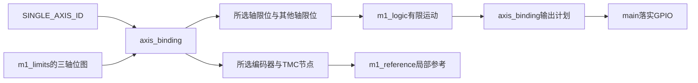

# 公共单轴验证入口

阶段72当前为AUDIT1输出锁定准备版，不是M1HOME/AXISHOME镜像，不发送旧CONFIG/DIR/HOME/JOG命令。正常启动及M999检查均保持HOMED0/ALLOWED0；三轴旧单轴成功记录仅在文件中，当前无RAM参考。MG90S夹爪接回前准备已完成，接回后先只读，正式开合另行授权。

阶段69已完成M3 D1寻66/退40及局部VALID，三轴分别有限HOME均有证据。参见docs/hardware_validation/axis_home_acceptance.md；不同启动会话不能合成整机零位。当前只保留M3 RAM参考，不追加动作。

阶段66已完成M2 D0寻128/退40及局部参考VALID实测。M3 D1走满200步无触发，停止且未退回。停机附近M3角度有反向变化，用户不确定是否触碰，原因不归类。当前板上M3已用动作会话、EN禁用。两轴分别烧录，M2 RAM参考已丢失，文件证据保留，不声明整机坐标。后续M3需先可靠支撑并确认触发位置，不自动追加动作。

当前硬件63：M2移近后获新许可执行一次D0 HOME，仍因200步内未采到低电平停止；没有退回、重试，M3未执行。当前M2停止USED1/EN禁用，115200/LOW。软件64三轴完整输入链测试及错误映射负对照通过，固件逻辑未改。下一步先取得明确M2触发位置，不扩大寻程，旧段落仅为历史。

当前以硬件62/软件61为准：M2趋近限位D0、M3为D1，依据为阶段56用户手动趋近符号与51/58/60的STEP活动窗口对照；20微步点动报告单独记录停稳偏移。通用HOME脚本已在62首次实机用于M2：一次D0、最多200步后无低电平，保护停机、参考无效，整轮停止，M3未执行。当前板上为M2动作会话USED1且EN禁用，不复位重放。三电机连接及共用EN是用户明确更新的条件，下面旧隔离接线要求为历史。正常生产DIR语义已于61修复且未部署，不可直接烧录自动回零固件。

软件阶段54已准备通用HOME监督：纯合同`axis_home_contract.ps1`只解析，`execute_axis_home_after_approval.ps1`负责一次动作及日志。需要显式轴号、已确认的趋近限位方向与文字依据、动作授权；默认及缺少方向时均在打开串口前拒绝。M2/M3目前没有方向确认事实，不能填入旧默认方向来绕过此条件。纯合同及默认门禁测试通过，Debug/Release各111项，未访问硬件。用户已断电，下午上电后重新获取会话、反馈、限位和输出；本段以下实测均是断电前历史。

阶段52已完成M3锁定20轮及一次20微步D0点动，约449ms观察DONE、驱动禁用。用户明确允许三个电机保持连接及共用EN上电，覆盖阶段50最初的隔离接线前提；所选轴发STEP，其余STEP和PA1保持低。未记录未选轴编码器，不声称其实体未动。当前板上AXISHOME1/AXIS:3动作版已用会话；M2/M3机械方向、精度和HOME仍待验证。阶段53的离线报告用真实记录分别检查动作合同与运动反馈，Debug/Release各109项通过；不能以报告通过自动授权下一动作。下述阶段50/51的隔离准备是当时历史方案，当前接线及授权以本段为准。

历史目录和状态机接口保留`m1_homing`名称。阶段50把轴差异收敛到`axis_binding`，M1/M2/M3共用同一套接收缓存、有限运动状态机、局部参考和截止端口。正常三轴回零仍由`svc_homing`负责，两者不同时运行。

阶段51已在M2接线下完成锁定版20轮检查和一次20微步D0点动，主机约455ms观察到DONE，驱动禁用。84点编码器有可辨识变化，但不是严格单调，停机后也有变化；方向和角度精度尚未验收。当前为AXISHOME1/AXIS:2动作版已使用会话，不是编译锁定。详细证据见[阶段51](../../docs/hardware_validation/20261021_m2_first_jog_51/README.md)。M3构建仍未部署。

## 依赖与数据流



阅读顺序为`axis_binding.h`的合同、`axis_binding.c`的映射、`axis_binding_tests.c`的输出验证，再看main中的Apply、Sample和CONFIG绑定。M1Test中历史字段m1_limit代表所选轴，other_limit代表其余两轴；硬件轴号不进入状态机。

## 板端对应关系

| SINGLE_AXIS_ID | 电机接口 | STEP | DIR | 限位 | 编码器 | TMC地址 |
|---|---|---|---|---|---|---|
| 1 | CN15 | PA6 | PD3 | PC10/CN3 | ENC_1/CN12 | 0 |
| 2 | CN16 | PA7 | PD4 | PC11/CN4 | ENC_2/CN13 | 1 |
| 3 | CN17 | PB0 | PD5 | PC12/CN5 | ENC_3/CN14 | 2 |

对应关系依据[PCB10_1/10_2核查记录](../../docs/hardware_validation/20261020_pcb_revision_audit/README.md)和当前Core引脚定义。main用编译断言检查位号；测试检查表内轴号、节点及掩码。测试不能证明实物插头当前插在哪里，UART地址映射也不能代替真实CONFIG读回。

EN为PD2，三驱动共用且低有效。输出计划只允许所选轴STEP置高，其他STEP和夹爪PA1始终拉低；初始化DIR均预载低电平。因为EN共用，实机动作时只能接所选轴电机，其余电机和夹爪必须断开。

LED1常亮，LED2/3/4继续对应板端M1/M2/M3限位，不随所选轴重新编号。M2限位对应LED3，M3对应LED4。

## 默认构建与协议身份

三个准备预设都显式关闭动作编译许可：

```powershell
cmake --preset TeachingM1HomingPrepare
cmake --build --preset TeachingM1HomingPrepare
cmake --preset TeachingM2HomingPrepare
cmake --build --preset TeachingM2HomingPrepare
cmake --preset TeachingM3HomingPrepare
cmake --build --preset TeachingM3HomingPrepare
```

M1保留M1HomingPrepare/M1HOME8和RAW_M1。M2/M3报告AxisHomingPrepare/AXISHOME1，并在M115显式带AXIS:2或AXIS:3；M114分别返回RAW_M2/RAW_M3。原M1 HOME脚本会拒绝其他轴身份，不会将M2镜像作为M1动作。

选轴只决定映射，不会自动赋予动作许可。错误轴号、在正常应用中使用选轴参数、把M1的89/400微步大点动配置用于M2/M3均在构建时拒绝。M2/M3默认仍20微步、50微步/秒、500ms点动截止，HOME最大寻200/退40/总5500ms；后者只是软件边界，当前不据此自动执行M2/M3 HOME。

## 只读检查和首次小点动

`query_axis_locked.ps1`默认在创建串口前拒绝，-SelfTest只检查身份合同。实际验证时复制到新的硬件记录目录，再显式-Connect、选择轴号；只发送M115/M408/M114/M119/M120/M121/M122，不配置驱动或请求动作。

`execute_axis_jog_after_approval.ps1`支持一次20微步D0点动，要求精确轴身份、未用会话、限位松开、编码器有效及配置确认。默认拒绝；-SelfTest不创建串口。使用-ExecuteAuthorized前，必须已得到对应轴、方向、范围的现场授权。脚本不发送HOME或DIR确认，不宣称已知道M2/M3趋近限位的方向。

20微步按当前16细分和4.5减速比约为电机轴2.25°、关节0.5°，名义用时约0.4s；这些是配置换算，不是实测角度。固件500ms硬截止，主机650ms监督，结束禁用，失败只停止、不重试、不自动反向。JOG完成后局部参考应保持UNSET，不能把点动当回零。

主机记录动作前、动作中和停机后编码器。相对基线的最大变化须在0.35..5.0电机轴度范围内，变化过小或异常大均不报告点动通过；该范围只判断是否有可辨识反馈，不是角度精度公差。最大变化的符号也不单独证明趋近限位方向。不要求每轮人工目视反馈。阶段51已按断电流程断开M1，仅M2接CN16；下一步M3验证前需再次断电，拔下M2 CN16，仅接M3 CN17，并支撑连杆防止禁用后下落。

## 电脑验收和未验证部分

轴映射测试每轴遍历32组控制条件和65536组初始低16位电平，共2097152种输出状态，验证未选STEP、PA1及无关引脚不受误写。三轴锁定版和动作候选均完成ARM构建；主机脚本合同检查及默认拒绝检查通过。

板上M1已验证有限HOME与局部参考；公共选轴重构已在M2完成一次小点动和所选编码器记录，未测实际STEP波形，也未验收机械方向、精度或回零。M1在本次重构后的适配及M3绑定仍待实机验证。正常三轴程序的M1方向已按实测修正，正式退回角度仍100/31/5°，不能直接以当前单轴准备代替正式三轴验收。
